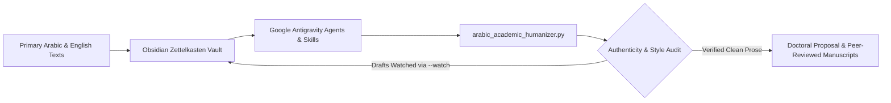

# Arabic Academic Research Toolkit

[](https://orcid.org/0009-0007-1780-7221)
[](LICENSE)
[](pyproject.toml)

Open-source Python tooling for auditing Arabic academic prose, enforcing methodological precision, removing AI-generated clichés, and supporting reproducible humanities research workflows integrated with **Obsidian (Zettelkasten)** and **Google Antigravity**.

## Research Context

Arabic-language scholarship in philosophy of religion, analytic epistemology, and classical Islamic philosophical theology (*Kalām*) frequently faces two technical bottlenecks:
1. **Methodological & Stylistic Drift**: AI-assisted drafting introduces translational clichés, vague generalizations, and polemical framing instead of analytical precision.
2. **Reproducibility & Knowledge Management**: Bridging classical Arabic primary editions, printed page citations, and contemporary analytic philosophy requires automated verification pipelines.

## Architecture: Obsidian + Google Antigravity Workflow



## Components

- **`arabic_academic_humanizer.py`** — Core static analyzer and rule-based purifier:
  - Detects and purges AI clichés, rhetorical filler, and journalistic calques.
  - Enforces analytical terminology (e.g., replacing polemical *critique/deconstruction* with *analytical & epistemological examination*).
  - Replaces ambiguous foreign loanwords with precise classical Arabic terms.
  - Computes a quantitative **Human Scholarly Index (0–100)** per draft.
- **`humanize.py`** — Unified CLI supporting:
  - Single-file inspection (`python humanize.py examples/sample_manuscript.md`)
  - Safe in-place purification with backup (`--in-place`)
  - Instant clipboard purification (`--clip`)
  - Live Obsidian vault folder watcher (`--watch ./research_drafts`)
- **`academic_humanizer_studio.py`** — Interactive RTL Gradio web studio with live metrics, rule violation tables, sample presets, and batch Markdown/TXT file processing.

## Quickstart & Testing

```bash
pip install -e .

# Run unit tests
python -m unittest discover -s tests -v

# Audit sample manuscript
python humanize.py examples/sample_manuscript.md

# Watch an Obsidian Zettelkasten folder live
python humanize.py --watch ./my_obsidian_vault/drafts

# Launch the interactive Gradio studio
python academic_humanizer_studio.py
```

## Citation

See [`CITATION.cff`](CITATION.cff) for machine-readable citation metadata:

> Kaci, Abderrahim (2026). *Arabic Academic Research Toolkit* (v0.2.0). University of Algiers 1. https://github.com/rhmkaci-eng/arabic-academic-research-toolkit — ORCID: [0009-0007-1780-7221](https://orcid.org/0009-0007-1780-7221)

## License

MIT License. See [LICENSE](LICENSE).
